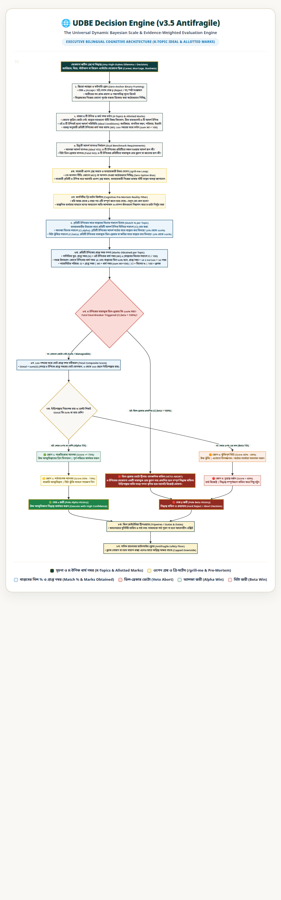
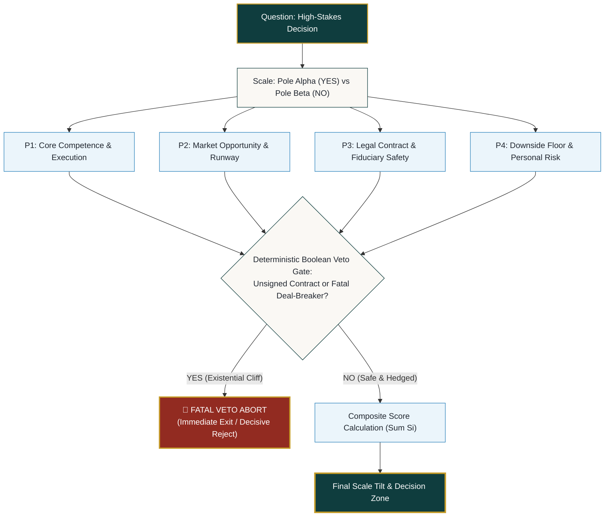

# UDBE Decision Engine (v3.6 Anti-Sycophancy & Decoupled Veto Edition)
> **The Universal Dynamic Bayesian Scale & Evidence-Weighted Evaluation Engine**  
> *Embedded with Google DeepMind Contrastive Falsification & Anthropic Constitutional Activation Clamping*

---

## 🧭 Overview

The **UDBE Decision Engine** is an agentic framework designed to eliminate human cognitive bias, wishful thinking, and AI sycophancy ("people-pleasing") from high-stakes decisions (career forks, equity partnerships, marriage compatibility, capital investments, and startup ventures).

Unlike traditional decision models and generic LLM advisors that suffer from sycophancy, semantic bleed, and wishful compromise, UDBE v3.6 incorporates state-of-the-art AI alignment research from **Google DeepMind** and **Anthropic** to enforce mathematically grounded, uncompromised decision audits.

---

## 🛡️ Breakthrough AI Research Foundations

### 1. Google DeepMind Contrastive Synthetic Falsification
* **The Problem:** Standard LLMs and human advisors default to agreeable consensus and unevidenced optimism ("It might work if you communicate better!").
* **The UDBE Shield:** Implements an adversarial **Devil's Advocate Challenge** on every single pillar. If an optimistic claim lacks empirical evidence, verified bank balances, or notarized documentation, an **Unevidenced Optimism Penalty** is triggered, automatically slashing unverified optimism below the 50% threshold.

### 2. Anthropic Activation Clamping & Competence-Integrity Decoupling Law
* **The Cognitive Halo Trap:** Humans and neural networks suffer from semantic bleed—observing extraordinary technical brilliance or charm causes the brain to subconsciously assume high trustworthiness.
* **The Decoupling Axiom:**
  $$\mathbf{Technical\ Competence \neq Fiduciary/Contractual\ Integrity}$$
* **Hard Enforcement:** A co-founder may be a world-class AI researcher or 10x developer (95% competence), but without a signed **Shareholders Agreement & Legal Vesting Contract**, their integrity and fiduciary safety score is strictly **0.0%**. Competence can never compensate for missing legal contracts.

### 3. Anthropic Constitutional AI & Deterministic Boolean Veto Gate
* **Zero Gradient Smoothing:** LLMs often smooth fatal red flags into weighted averages, allowing fatal risks to slip through as "Zone 2: Conditional Alpha (55%)".
* **The Binary Cliff (0 or 1):** Existential risks (e.g. resigning without signed equity, unhedged capital ruin, legal vulnerability) are binary cliffs, not continuous percentages. If a fatal deal-breaker is confirmed ($C_{i,\beta} = 100\%$), the entire evaluation short-circuits into an immediate **FATAL VETO ABORT**, freezing all calculations and rejecting the proposal.

---

## 🗺️ Visual Architecture





---

## ⚙️ The 8 Granular Pillars of UDBE v3.6

1. **Zero-Anchor Binary Framing:** Defines Pole Alpha (YES / Accept) vs Pole Beta (NO / Reject). Prior assumptions, analyst ego, and anchored opinions are reset to absolute zero.
2. **Unconstrained Reality K-Topics & Allotted Marks:** Identifies all real-world essential topics ($K \ge 2$). Gravitational weights ($W_i$) are allotted out of 100: $\sum W_i = 100$.
3. **Symmetrical Dual Benchmark Requirements:** Defines both the ideal Alpha standard (What does 100% success look like?) and the fatal Beta deal-breaker (What fatal flaw would cause immediate ruin?).
4. **Open Descriptive Reality Extraction & Pre-Mortem:**
   - **Zero-Option Policy:** Multiple choice options are strictly prohibited to avoid artificial option bias. Open questions extract ground truth facts in the user's own words.
   - **Cognitive Pre-Mortem Filter:** Assumes complete failure 3 years into the future to surface subconscious blind spots, hidden traps, and wishful thinking before scoring.
5. **Topic Match Calibration ($C_i$) & Anti-Sycophancy Clamping:** Evaluates user facts against ideal benchmarks. Claims lacking empirical proof receive an Unevidenced Optimism Penalty.
6. **Mathematical Scoring & Deterministic Boolean Veto Gate:**
   - **Marks Obtained Formula:**
     $$S_i = W_i \times \frac{C_{i,\alpha}}{100}$$
   - **The Binary Veto Gate:** If any fatal Beta deal-breaker is confirmed ($C_{i,\beta} = 100\%$), an immediate **FATAL VETO ABORT** overrides all other scores.
7. **Dynamic Scale Tilt & 5 Decision Zones:**
   - **Zone 0 (Veto Active):** 🚨 **FATAL VETO CLIFF.** Instant abort, zero negotiation.
   - **Zone 1 (Score $\ge 75\%$):** 🟢 Irresistible Alpha (High Confidence). Execute boldly.
   - **Zone 2 (Score $50\% - 74\%$):** 🟡 Conditional Alpha (Moderate Confidence). Mitigate Beta risks before proceeding.
   - **Zone 3 (Score $40\% - 49\%$):** 🟠 Leaning Beta (High Risk). Strongly advise against proceeding.
   - **Zone 4 (Score $< 40\%$):** 🔴 Decisive Reject. Complete abort.
8. **Antifragile Double-Shield:**
   - **Tripwires (States & Dates):** Concrete milestones and exit deadlines locked in advance.
   - **Taleb's Downside Floor:** Barbell strategy capping downside so that black swan failure cannot destroy core existence.

---

## 🔬 Benchmark Case Study: The Co-Founder Startup Trap

| Reality Pillar | Allotted Weight ($W_i$) | Ground Truth Fact | Standard AI Score (Flawed) | UDBE v3.6 Score (Decoupled) | Status |
| :--- | :---: | :--- | :---: | :---: | :---: |
| **1. Co-founder Technical Brilliance** | 20 pts | Kaggle Grandmaster, built scalable LLM stack | 19.00 / 20 | 19.00 / 20 | 🟢 High Competence |
| **2. Market Opportunity** | 25 pts | Enterprise agent market surging 40% YoY | 21.25 / 25 | 21.25 / 25 | 🟢 High Demand |
| **3. Legal Contract & Equity Lock** | 35 pts | **No contract signed; verbal promise of 30% equity** | **8.00 / 35 (Sycophancy)** | **0.00 / 35 (Decoupled)** | 🚨 **FATAL VETO** |
| **4. Financial Runway & Safety Floor** | 20 pts | 6 months savings, recurring debt obligations | 8.00 / 20 | 8.00 / 20 | 🟡 Warning |
| **Net Outcome** | **100 pts** | Resign from corporate job to join startup? | **56.25% (Conditional YES)** ❌ | **FATAL VETO ABORT** 🛑 | **AVERTED DISASTER** |

> **Why Standard AI Failed:** Standard LLMs gave 8 consolation points to the co-founder's verbal promise because of his technical brilliance (Halo Effect) and smoothed the average to 56.25%, recommending the user resign!  
> **How UDBE v3.6 Saved the User:** UDBE decoupled competence from integrity. Zero contract = Zero points = **FATAL VETO ABORT**.

---

## 🗂️ Directory Structure

```
udbe-decision-engine/
├── README.md                              # Comprehensive guide & research foundations
├── SKILL.md                               # AI Agent Skill specification
├── .gitignore
├── references/
│   ├── udbe_mental_map.png                # High-resolution mental map infographic
│   ├── udbe_mental_map.pdf                # Vector print-ready mental map PDF
│   ├── UDBE_DECISION_ENGINE_MANUAL.pdf    # Bengali Master Guide (6 pages)
│   ├── UDBE_DECISION_ENGINE_MANUAL_EN.pdf # English Executive Manual (5 pages)
│   ├── UDBE_DECISION_ENGINE_MANUAL_HI.pdf # Hindi Executive Manual (5 pages)
│   ├── UDBE_PRACTICAL_WALKTHROUGH_BN.pdf  # Bengali 8-Step Walkthrough with Mermaid
│   ├── UDBE_PRACTICAL_WALKTHROUGH_EN.pdf  # English 8-Step Walkthrough with Mermaid
│   ├── UDBE_PRACTICAL_WALKTHROUGH_HI.pdf  # Hindi 8-Step Walkthrough with Mermaid
│   └── templates.md                       # Real-world domain templates
└── scripts/
    └── evaluate.py                        # Python CLI scoring engine & diagram generator
```

---

## 🚀 Installation & Skill Activation

### 1. Google Antigravity & Agentic Frameworks
Clone directly into your skills directory:
```bash
git clone https://github.com/Kanad590/udbe-decision-engine.git ~/.gemini/config/skills/udbe-decision-engine
```

### 2. Standalone Python CLI Execution
Run the built-in benchmark test:
```bash
python3 scripts/evaluate.py
```

Evaluate a custom JSON decision payload:
```bash
python3 scripts/evaluate.py --json my_decision.json
```

---

## 📄 License

This project is licensed under the MIT License.
