# 🌐 UDBE Decision Engine (v3.6 Anti-Sycophancy & Decoupled Veto Edition)
### The Universal Dynamic Bayesian Scale & Evidence-Weighted Evaluation Engine
*Embedded with Google DeepMind Contrastive Synthetic Falsification & Anthropic Constitutional Activation Clamping*

> **কোর ফিলোসফি:** *"তত্ত্ব দাবি করবে, বাস্তব প্রমাণ দেবে, দাঁড়িপাল্লা রায় দেবে—কোনো পূর্বানুমানকে অন্ধভাবে ডিফেন্ড করা কঠোরভাবে নিষিদ্ধ। অনিশ্চয়তা দূর করা অসম্ভব, কিন্তু নিজেকে অ্যান্টিফ্র্যাজাইল (অপরাজেয়) করা সম্পূর্ণ সম্ভব।"*

---

## ⚡ দ্রুত প্রয়োগ নির্দেশিকা (Quick Execution Protocol)

যেকোনো প্রশ্নের সামনে পড়লে সহকারীকে নিচের ৮টি সুনির্দিষ্ট ধাপে ইঞ্জিন পরিচালনা করতে হবে:

```
   ধাপ ১: বাইনারি ফ্রেম ও অ্যাঙ্করিং রিসেট (মেরু α বনাম মেরু β)
   ধাপ ২: K-সংখ্যক বাস্তব স্তম্ভ নির্ধারণ ও ১০০ নম্বরের মহাকর্ষীয় ওয়েট বণ্টন (Sum = ১০০)
   ধাপ ৩: দ্বিমুখী বেঞ্চমার্ক সংজ্ঞায়ন (আলফা জেতার শর্ত বনাম বিটার ডিল-ব্রেকার)
   ধাপ ৪: বর্ণনামূলক /grill-me লুপ ও কগনিটিভ প্রি-মর্টেম ফিল্টার (অপশনহীন র-ডাটা সংগ্রহ)
   ধাপ ৫: ডিপমাইন্ড কন্ট্রাস্টিভ চ্যালেঞ্জ ও সততা-দক্ষতা পৃথকীকরণ (Unevidenced Optimism Penalty & Decoupling)
   ধাপ ৬: গাণিতিক স্কোর গণনা ও ডিটারমিনিস্টিক বাইনারি ভেটো গেট (Fatal Veto Cliff Check)
   ধাপ ৭: দাঁড়িপাল্লার পরিবর্তন (Delta) পর্যবেক্ষণ ও নিরপেক্ষ রায় ঘোষণা
   ধাপ ৮: অ্যান্টিফ্র্যাজাইল লক (কিল ক্রাইটেরিয়া ট্রিপওয়্যার ও ডাউনসাইড ফ্লোর নির্ধারণ)
```

---

## 🧭 ১. ইঞ্জিনের মৌলিক মেকানিক্স (Core Mechanics & Antifragile Shields)

### 🔹 ১. জিরো-অ্যাঙ্কর আইন (Zero-Anchor Law)
* প্রশ্নের শুরুতে বিশ্লেষক বা ব্যবহারকারী কী ধারণা করেছিলেন, তা সম্পূর্ণরূপে শূন্যে রিসেট করতে হবে।
* **নিজের কোনো পূর্বের মন্তব্য বা মতামতকে জাস্টিফাই করা কঠোরভাবে নিষিদ্ধ।**
* দাঁড়িপাল্লা প্রারম্ভিক অবস্থায় সম্পূর্ণ নিরপেক্ষ থাকবে।

### 🔹 ২. আনকনস্ট্রেইন্ড বাস্তব K-টি টপিক নির্ধারণ (K-Reality Topics / Ideal Benchmarks)
* কোনো কৃত্রিম কোটা (যেমন জোর করে ৫ বা ৬টি স্তম্ভ বানানো) সম্পূর্ণ নিষিদ্ধ।
* বাস্তবে যতগুলো আসল ফ্যাক্টর বিদ্যমান, ঠিক ততগুলোই স্তম্ভ ($K$) থাকবে:
  * সিদ্ধান্ত ২টি বিষয়ের ওপর দাঁড়িয়ে থাকলে: $K = ২$।
  * বড় জটিল সিস্টেমে ৫০টি বিষয় থাকলে: $K = ৫০$।
* **এই K-টি টপিকই হলো আদর্শ পরিস্থিতি (Ideal Conditions):** প্রতিটি টপিক হলো সফল সিদ্ধান্তের জন্য কাঙ্ক্ষিত মানদণ্ড (যেমন: ক্যারিয়ার স্থায়িত্ব, মানসিক টান, সততা, পারিবারিক সম্মতি ইত্যাদি)।
* **প্রতিটি টপিকের ধার্য নম্বর বরাদ্দ ($W_i$):** মোট ১০০ নম্বরের পরীক্ষায় যেমন সিলেবাসের গুরুত্ব অনুযায়ী নম্বর ধার্য থাকে, তেমনই প্রতিটি K-টপিকে **ধার্য নম্বর (Allotted Marks)** দেওয়া হয়: $\sum_{i=1}^K W_i = ১০০$।

### 🔹 ৩. দ্বিমুখী আদর্শ মানদণ্ড সংজ্ঞায়ন (Dual Benchmark Requirements)
* কেবল "আলফা (হ্যাঁ) জিতবে কীভাবে" সেই প্রশ্ন করা নিষিদ্ধ (Positive Test Bias প্রতিরোধ)।
* প্রতিটি K-টপিকের জন্য সমান গুরুত্বে দুটি বিপরীতমুখী আদর্শ মানদণ্ড ঠিক করতে হবে:
  * **আলফা আদর্শ মানদণ্ড (Ideal YES):** ওই K-টপিকে সফল হওয়ার আদর্শ শর্ত কী?
  * **বিটা ডিল-ব্রেকার মানদণ্ড (Fatal NO):** ওই K-টপিকে মারাত্মক রেড ফ্ল্যাগ বা ধ্বংসের ডিল-ব্রেকার কী?

### 🔹 ৪. বর্ণনামূলক গ্রাউন্ড রিয়ালিটি ও ওপেন `/grill-me` প্রটোকল
* **কোনো অপশন বা এমসিকিউ (MCQ) দেওয়া কঠোরভাবে নিষিদ্ধ:** অপশন দিলে ব্যবহারকারী পূর্বনির্ধারিত কৃত্রিম ছকে আবদ্ধ হয়ে পড়ে (Option Bias)।
* সহকারী প্রতিটি K-টপিক ধরে সরাসরি একবারে একটি উন্মুক্ত প্রশ্ন করবে এবং ব্যবহারকারীকে **নিজের ভাষায় বিস্তারিত বর্ণনামূলক (Descriptive) বাস্তব সত্য** জানাতে বলতে হবে।
* **কগনিটিভ প্রি-মর্টেম ফিল্টার:** প্রশ্নোত্তরের সময় কাল্পনিক বিপর্যয়ের প্রশ্ন দিয়ে (*"ধরি আজ থেকে ৩ বছর পর এটি সম্পূর্ণ ধ্বংস হয়ে গেছে—কেন হলো?"*) মনের অতি-আশাবাদ ও গোপন ফাঁদ বের করে এনে অবিকৃত র-ডাটা (Raw Facts) নিশ্চিত করতে হবে।

### 🔹 ৫. প্রতিটি টপিকের সাথে বাস্তবের মিলের শতাংশ নির্ধারণ (Match % per Topic)
ব্যবহারকারীর বর্ণনামূলক বাস্তব উত্তরের সাথে প্রতিটি আদর্শ K-টপিক মিলিয়ে **বাস্তবের মিলের শতাংশ ($C_i \in [0\%, 100\%]$)** হিসাব করা:
* **আলফা মিল শতাংশ ($C_{i,\alpha}$):** আদর্শ K-টপিকের শর্তের সাথে বাস্তবে কত শতাংশ মিলছে? ($০\%$ থেকে $১০০\%$)
* **বিটা ঝুঁকি শতাংশ ($C_{i,\beta}$):** K-টপিকের মারাত্মক ডিল-ব্রেকার বা ক্ষতির শর্ত বাস্তবের সাথে মিলছে কি? ($০\%$ থেকে $১০০\%$)

### 🔹 ৬. প্রতিটি টপিকের প্রাপ্ত নম্বর গণনা (Pillar Scoring Formula)
* প্রতিটি K-টপিকের যত নম্বর ধার্য হয়েছিল ($W_i$), বাস্তবের মিলের শতাংশ ($C_i\%$) অনুযায়ী সেই ধার্য নম্বরের মধ্য থেকে **প্রাপ্ত নম্বর ($S_i$)** বের করা হয়:
  $$S_i = W_i \times \frac{C_i}{১০০}$$
  $$\text{প্রাপ্ত নম্বর } (S_i) = \text{ধার্য নম্বর } (W_i) \times \left( \frac{\text{বাস্তবের মিলের শতাংশ } (C_i)}{১০০} \right)$$
* **সহজ উদাহরণ:** কোনো টপিকের ধার্য নম্বর ২৫ এবং বাস্তবের সাথে মিল ৮০% হলে, প্রাপ্ত নম্বর = ২৫ $\times$ ৮০/১০০ = ২০ নম্বর (২৫ নম্বরের মধ্যে ২০ নম্বর পেল)।
* **প্যারামিটারসমূহের স্পষ্ট সংজ্ঞা (Parameter Definitions):**
  * **$S_i$** = ওই নির্দিষ্ট K-টপিকে অর্জিত প্রাপ্ত নম্বর (Points/Marks earned by pillar $P_i$)।
  * **$W_i$** = ওই K-টপিকের ধার্য নম্বর বা মহাকর্ষীয় ওয়েট (Allotted Marks, যেখানে $\sum W_i = 100$)।
  * **$C_i$** = আদর্শ K-টপিকের সাথে বাস্তবের মিলের শতাংশ (Match Percentage from ground reality, $0\% - 100\%$)।
  * **$১০০$** = শতাংশকে প্রাপ্ত নম্বরে রূপান্তরের ধ্রুবক (Normalization Factor)।
  * **$S_{\text{total}} = \sum_{i=1}^K S_i$** = ১০০ নম্বরের মধ্যে সমস্ত K-টপিকে প্রাপ্ত নম্বরের মোট যোগফল (০ থেকে ১০০ স্কেলে দাঁড়িপাল্লার অবস্থান)।

---

## 🛡️ এআই গবেষণালব্ধ অ্যান্টি-বায়াস ও অ্যান্টি-সাইকোফ্যান্সি প্রটোকল (AI Anti-Bias & Constitutional Shields)

### 🔹 ৭. Google DeepMind Contrastive Synthetic Falsification (বিপরীতমুখী অসত্য প্রমাণ নীতি)
* **সমস্যা:** সাধারণ এআই ব্যবহারকারীর মিষ্টি কথা বা কোনো আশাব্যঞ্জক দাবির সামনে পড়লে নরম সুরে হ্যাঁ বলে এবং অবচেতনভাবে তোষামোদি করে ("People-Pleasing" / Sycophancy)।
* **ডিপমাইন্ড সমাধান:** প্রতিটি K-টপিকে কোনো দাবির পক্ষে শক্ত দলিল না থাকলে তাকে "ফ্রি পয়েন্ট" বা অন্ধ আশাবাদে নম্বর দেওয়া সম্পূর্ণ নিষিদ্ধ (**Unevidenced Optimism Penalty**)।
* প্রতিটি পিলারে সহকারীকে একটি কঠোর **অ্যাডভারসারিয়াল অপজিশন (Devil's Advocate Challenge)** খাড়া করতে হবে:
  > *"যদি এই দাবিটির পক্ষে কোনো আইনি চুক্তি, অকাট্য ব্যাংক ব্যালেন্স বা লিখিত সাক্ষ্য না থাকে, তবে আলফা স্কোর অবিলম্বে ৫০%-এর নিচে নামিয়ে আনা বাধ্যতামূলক।"*

### 🔹 ৮. Anthropic Activation Clamping & Competence-Integrity Decoupling Law (দক্ষতা বনাম সততা পৃথকীকরণ নীতি)
* **কগনিটিভ হ্যালো ইফেক্ট (Halo Effect Trap):** মানব মস্তিষ্কে ও এআই-এর নিউরাল নেটওয়ার্কে একটি মারাত্মক বিভ্রম ঘটে—কারো অসাধারণ মেধা বা প্রযুক্তিগত দক্ষতা দেখলে মানুষ ধরে নেয় সে মানুষ হিসেবেও বিশ্বস্ত এবং সৎ!
* **পৃথকীকরণ স্বতঃসিদ্ধ (Decoupling Axiom):**  
  $$\mathbf{Technical\ Competence \neq Fiduciary/Contractual\ Integrity}$$
* **কঠোর নিয়ম:**
  * পার্টনার বা সহ-উদ্যোক্তা বিশ্বের সেরা কোডার, শীর্ষ এআই গবেষক বা তুমুল জনপ্রিয় ব্যক্তি হতে পারেন (কারিগরি দক্ষতায় তার স্কোর ৯৫% হতে পারে)।
  * কিন্তু **স্বাক্ষরিত আইনি চুক্তিপত্র (Shareholders Agreement / Legal Vesting)** ছাড়া তার বিশ্বস্ততা বা আইনি সুরক্ষার স্তম্ভে স্কোর হবে **হাতেকলমে ০%**।
  * দক্ষতার আলো দিয়ে সততা বা আইনি সুরক্ষার অন্ধকারকে ঢেকে রাখা নিউরাল নেটওয়ার্কে স্টিয়ারিং ক্ল্যাম্পিংয়ের মাধ্যমে সরাসরি ব্লক করা হয়েছে।

### 🔹 ৯. Anthropic Constitutional AI & Deterministic Boolean Veto Gate (ডিটারমিনিস্টিক বাইনারি ভেটো গেট)
* **গ্রেডিয়েন্ট স্মুদিং বর্জন (Zero Gradient Smoothing):** সাধারণ এআই গড়ে ভালো নম্বর পেলে ডিল-ব্রেকার থাকা সত্ত্বেও বিষয়টিকে "শর্তসাপেক্ষ হ্যাঁ" বলে পাশ করিয়ে দেয়। এটি চরম বিপর্যয় ডেকে আনে।
* **বাইনারি ক্লিফ রুল (Binary Cliff: 0 অথবা 1):**
  * মারাত্মক অস্তিত্বের হুমকি (যেমন: চুক্তি ছাড়া চাকরি ছেড়ে দেওয়া, সব টাকা এক জায়গায় ফেলে দেওয়া, ব্ল্যাকমেইল বা আইনি ফাঁদ) কোনো পার্সেন্টেজ বা গড় নম্বরের বিষয় নয়। এটি একটি বাইনারি ক্লিফ।
  * যদি কোনো ডিল-ব্রেকার ১০০% সত্য প্রমাণিত হয় ($C_{i,\beta} = 100\%$), দাঁড়িপাল্লার বাকি সমস্ত পয়েন্ট তাৎক্ষণিকভাবে নস্যাৎ হয়ে **FATAL VETO ABORT** কার্যকর হবে।
  * কোনো "কিন্তু", কোনো "যদি" বা কোনো সমঝোতা থাকবে না। পুরো সিদ্ধান্ত তাৎক্ষণিক বাতিল ঘোষণা করা হবে।

---

## ⚖️ ২. ডিসিশন থ্রেশহোল্ড, ট্রিপওয়্যার ও ডাউনসাইড ফ্লোর

### 🔹 ১০. ডিসিশন থ্রেশহোল্ড ও দাঁড়িপাল্লার অবস্থান
* **স্কোর $\ge ৭৫\%$:** 🟢 জোন ১: অপ্রতিরোধ্য 'হ্যাঁ' (High Confidence Alpha)।
* **স্কোর ৫০% – ৭৪%:** 🟡 জোন ২: শর্তসাপেক্ষ 'হ্যাঁ' (Conditional Alpha - Manage Beta Risks)।
* **স্কোর ৪০% – ৪৯%:** 🟠 জোন ৩: উচ্চ ঝুঁকিপূর্ণ 'না' (High Risk Beta)।
* **স্কোর $< ৪০\%$:** 🔴 জোন ৪: চূড়ান্ত 'না' (Decisive Beta / Hard Abort)।
* **যেকোনো ডিল-ব্রেকার কার্যকর হলে:** 🚨 জোন ০: ডিটারমিনিস্টিক ভেটো বাতিল (FATAL VETO ABORT)।

### 🔹 ১১. কিল ক্রাইটেরিয়া ও ট্রিপওয়্যার (Tripwires Shield)
* মানুষের খামখেয়ালিপনা ও মন বদলানোর ঝুঁকি ঠেকাতে সিদ্ধান্তের দিনই সুনির্দিষ্ট **তারিখ ও শর্ত (States & Dates)** ক্যালেন্ডারে লক করতে হবে।
* *"যদি অমুক তারিখের মধ্যে X শর্ত পূরণ না হয়, অথবা যদি অপরপক্ষ Y রেড-লাইন অতিক্রম করে, তবে কোনো আবেগ ছাড়াই তাৎক্ষণিক এক্সিট (Hard Exit) নেওয়া হবে।"*

### 🔹 ১২. অ্যান্টিফ্র্যাজাইল ডাউনসাইড ফ্লোর (Antifragile Downside Floor Shield)
* Nassim Taleb-এর বারবেল স্ট্র্যাটেজি প্রয়োগ: আলফা যদি ভাগ্যের চরম ধাক্কায় (Black Swan) ১০০% ফেলও করে, ব্যবহারকারীর মূল অস্তিত্ব, ক্যারিয়ার বা মানসিক শান্তি যাতে কখনো ধ্বংস না হয়, সেই সেফটি নেট নিশ্চিত করতে হবে (Capped Downside, Convex Upside)।

---

## 🗺️ ইউনিভার্সাল মেন্টাল ম্যাপ (UDBE v3.6 Flowchart)

```mermaid
flowchart TD
    classDef startNode fill:#0F3D3E,stroke:#C59B27,stroke-width:2.5px,color:#fff;
    classDef framingNode fill:#FAF8F4,stroke:#0F3D3E,stroke-width:1.5px,color:#222831;
    classDef diamondNode fill:#FAF8F4,stroke:#C59B27,stroke-width:2px,color:#222831;
    classDef interviewNode fill:#FEF9E7,stroke:#F1C40F,stroke-width:1.5px,color:#222831;
    classDef calibrationNode fill:#EBF5FB,stroke:#1B4F72,stroke-width:2px,color:#1A5276;
    classDef mathNode fill:#EBF5FB,stroke:#1B4F72,stroke-width:2px,color:#222831;
    classDef vetoDiamond fill:#FADBD8,stroke:#C0392B,stroke-width:2px,color:#78281F;
    classDef vetoAbort fill:#922B21,stroke:#C59B27,stroke-width:2.5px,color:#fff;
    classDef zoneGreen fill:#E9F3F0,stroke:#2E6F5E,stroke-width:1.5px,color:#145A32;
    classDef zoneYellow fill:#FEFDE8,stroke:#D4AC0D,stroke-width:1.5px,color:#7D6608;
    classDef zoneOrange fill:#FBEEE6,stroke:#E67E22,stroke-width:1.5px,color:#7E5109;
    classDef zoneRed fill:#FBECE9,stroke:#B84A39,stroke-width:1.5px,color:#78281F;
    classDef alphaFinal fill:#1E8449,stroke:#C59B27,stroke-width:2.5px,color:#fff;
    classDef betaFinal fill:#922B21,stroke:#C59B27,stroke-width:2.5px,color:#fff;
    classDef lockNode fill:#2E4053,stroke:#C59B27,stroke-width:2px,color:#fff;

    Start(["শুরু: জটিল জীবন বা ক্যারিয়ার সিদ্ধান্ত<br/>(UDBE v3.6 Anti-Sycophancy Engine)"]):::startNode

    Reset["১. বাইনারি ফ্রেম ও জিরো-অ্যাঙ্কর রিসেট<br/>• মেরু α (কাজটি করা / একমত হওয়া) বনাম মেরু β (না করা / প্রত্যাখ্যান)<br/>• মন ও এআই-এর পূর্বের সমস্ত মতামত ১০০% মুছে সম্পূর্ণ নিরপেক্ষ অবস্থানে যাওয়া"]:::framingNode

    Pillars["২. আনকনস্ট্রেইন্ড বাস্তব K-টি টপিক নির্ধারণ ও ধার্য নম্বর বরাদ্দ<br/>• বাস্তবে যতগুলো আসল ফ্যাক্টর বিদ্যমান ঠিক ততগুলোই স্তম্ভ (K-টি টপিক)<br/>• ১০০ নম্বরের মহাকর্ষীয় গুরুত্ব বণ্টন: sum(Wi) = ১০০"]:::framingNode

    DualSpec["৩. দ্বিমুখী আদর্শ মানদণ্ড সংজ্ঞায়ন (Dual Benchmarks)<br/>• আলফা আদর্শ মানদণ্ড (Ideal YES): এই টপিকে সফল হওয়ার আদর্শ শর্ত কী?<br/>• বিটা ডিল-ব্রেকার মানদণ্ড (Fatal NO): মারাত্মক ধ্বংসাত্মক রেড-ফ্ল্যাগ কী?"]:::framingNode

    G1["৪ক. বর্ণনামূলক গ্রাউন্ড রিয়ালিটি ও ওপেন /grill-me প্রটোকল<br/>• কোনো অপশন বা MCQ দেওয়া কঠোরভাবে নিষিদ্ধ<br/>• ব্যবহারকারীকে সরাসরি উন্মুক্ত প্রশ্নের মাধ্যমে নিজের ভাষায় বাস্তব র-ডাটা দিতে বলা"]:::interviewNode

    G2["৪খ. কগনিটিভ প্রি-মর্টেম ও ডিপমাইন্ড কন্ট্রাস্টিভ চ্যালেঞ্জ<br/>• ধরি আজ থেকে ৩ বছর পর এটি সম্পূর্ণ ধ্বংস হয়ে গেছে—বলুন তো কেন হলো?<br/>• প্রমাণ ছাড়া কোনো ইতিবাচক আশাবাদ গ্রহণ করা নিষিদ্ধ (Unevidenced Optimism Penalty)"]:::interviewNode

    Calib["৫. সততা বনাম দক্ষতা পৃথকীকরণ ও মিলের শতাংশ নির্ধারণ<br/>• Competence != Integrity: দুর্দান্ত কোডার হলেও চুক্তি ছাড়া সততা ০%<br/>• আলফা মিল শতাংশ (Ci,alpha) ও বিটা ঝুঁকি শতাংশ (Ci,beta) নির্ধারণ"]:::calibrationNode

    M1["৬ক. প্রতিটি স্তম্ভের স্কোর গণনা<br/>Si = Wi x (Ci / ১০০)"]:::mathNode

    VetoCheck{"৬খ. ডিটারমিনিস্টিক বাইনারি ভেটো গেট<br/>Fatal Deal-Breaker Triggered (Ci,beta = 100%)?"}:::vetoDiamond

    VetoAbort["🔴 ডিল-ব্রেকার ভেটো ট্রিগার: তাৎক্ষণিক বাতিল (FATAL VETO ABORT)<br/>K-টপিকের যেকোনো একটি মারাত্মক অস্তিত্বের ঝুঁকি নিশ্চিত হলে সমস্ত গণনা নস্যাৎ!<br/>কোনো গ্রেডিয়েন্ট স্মুদিং ছাড়াই সরাসরি রিজেক্ট ঘোষণা।"]:::vetoAbort

    M2["৬গ. মোট আলফা স্কোর সমীকরণ (Composite Alpha Score)<br/>• Stotal = sum(Si) (সমস্ত K-টপিকে অর্জিত পয়েন্টের যোগফল, ০ থেকে ১০০ স্কেলে দাঁড়িপাল্লার সামগ্রিক ভর)"]:::mathNode

    Tilt{"৭ক. দাঁড়িপাল্লার নিরপেক্ষ রায় ও ডেল্টা শিফট<br/>Stotal কি ৫০% বা তার বেশি?"}:::diamondNode

    Z1["🟢 জোন ১: অপ্রতিরোধ্য আলফা (Score >= 75%)<br/>উচ্চ আত্মবিশ্বাসের গ্রিন সিগন্যাল | পূর্ণ শক্তিতে কার্যকর করুন"]:::zoneGreen
    Z2["🟡 জোন ২: শর্তসাপেক্ষ আলফা (Score 50% - 74%)<br/>মাঝারি আত্মবিশ্বাস | বিটা ঝুঁকি সামলে পদক্ষেপ নিন"]:::zoneYellow
    AlphaWin["🟢 মেরু α জয়ী (Pole Alpha Victory)<br/>উচ্চ আত্মবিশ্বাসে সিদ্ধান্ত কার্যকর করুন (Execute with High Confidence)"]:::alphaFinal

    Z3["🟠 জোন ৩: ঝুঁকিপূর্ণ বিটা (Score 40% - 49%)<br/>উচ্চ ঝুঁকি | এগোনো বিপজ্জনক / কঠোর সতর্কতা অবলম্বন করুন"]:::zoneOrange
    Z4["🔴 জোন ৪: চূড়ান্ত বর্জন (Score < 40%)<br/>হার্ড রিজেক্ট | সিদ্ধান্ত সম্পূর্ণরূপে বাতিল করে পিছু হটুন"]:::zoneRed
    BetaWin["🔴 মেরু β জয়ী (Pole Beta Victory)<br/>সিদ্ধান্ত বাতিল ও প্রত্যাহার (Hard Reject / Abort Decision)"]:::betaFinal

    L1["৮ক. কিল ক্রাইটেরিয়া ট্রিপওয়্যার (Tripwires / States & Dates)<br/>• ক্যালেন্ডারে সুনির্দিষ্ট তারিখ ও শর্ত লক: সময়মতো শর্ত পূরণ না হলে আবেগহীন এক্সিট"]:::lockNode
    L2["৮খ. নাসিম তালেবের ডাউনসাইড ফ্লোর (Antifragile Safety Floor)<br/>• ব্ল্যাক সোয়ান বা চরম খারাপ ধাক্কা এলেও যাতে অস্তিত্ব অক্ষত থাকে (Capped Downside)"]:::lockNode

    Start --> Reset --> Pillars --> DualSpec --> G1 --> G2 --> Calib --> M1

    M1 --> VetoCheck
    VetoCheck -- "হ্যাঁ: ডিল-ব্রেকার প্রমাণিত (Ci,beta = 100%)" --> VetoAbort --> BetaWin
    VetoCheck -- "না: কোনো ভেটো নেই (Safe / Manageable)" --> M2 --> Tilt

    Tilt -- "হ্যাঁ: স্কোর ৫০% বা বেশি (Alpha Tilt)" --> Z1 --> Z2 --> AlphaWin
    Tilt -- "না: স্কোর ৫০% এর কম (Beta Tilt)" --> Z3 --> Z4 --> BetaWin

    AlphaWin & BetaWin --> L1 --> L2
```




---

## 🛠️ স্বয়ংক্রিয় পাইথন টুল ব্যবহার (Automated Script Execution)

এই স্কিলের সাথে একটি স্বয়ংক্রিয় পাইথন ক্যালকুলেটর যুক্ত রয়েছে যা শূন্য ভুলে দ্রুত হিসাব কষে দেয়:

```bash
# JSON ডাটা ফাইল দিয়ে রান করা
python3 ~/.gemini/config/skills/udbe-decision-engine/scripts/evaluate.py --json decision_input.json

# সরাসরি ডিফল্ট বেন্চমার্ক রান করা (কো-ফাউন্ডার ডিলেমা টেস্ট)
python3 ~/.gemini/config/skills/udbe-decision-engine/scripts/evaluate.py
```

---

## 🔒 মেমোরি ও কগনিটিভ স্বাস্থ্য রক্ষা আইন

> [!IMPORTANT]
> **স্থির আউটপুট বনাম প্রসেস:**  
> কোনো সিদ্ধান্তের নির্দিষ্ট পার্সেন্টেজ, রায় বা ব্যক্তির নাম মেমোরিতে লিখে রাখা কঠোরভাবে নিষিদ্ধ; কারণ তা ভবিষ্যতে রিজিডিটি তৈরি করে।  
> মেমোরিতে কেবল এই **বিশ্লেষণ মেথডোলজি ও অ্যান্টিফ্র্যাজাইল অ্যালগরিদমটি** স্থায়ী থাকবে। প্রতিটি নতুন সিদ্ধান্তে দাঁড়িপাল্লা স্বাধীন ও জীবন্ত থাকবে।
