# 🌐 UDBE Decision Engine (v3.5 Antifragile Edition)
### The Universal Dynamic Bayesian Scale & Evidence-Weighted Evaluation Engine

> **কোর ফিলোসফি:** *"তত্ত্ব দাবি করবে, বাস্তব প্রমাণ দেবে, দাঁড়িপাল্লা রায় দেবে—কোনো পূর্বানুমানকে অন্ধভাবে ডিফেন্ড করা কঠোরভাবে নিষিদ্ধ। অনিশ্চয়তা দূর করা অসম্ভব, কিন্তু নিজেকে অ্যান্টিফ্র্যাজাইল (অপরাজেয়) করা সম্পূর্ণ সম্ভব।"*

---

## ⚡ দ্রুত প্রয়োগ নির্দেশিকা (Quick Execution Protocol)

যেকোনো প্রশ্নের সামনে পড়লে সহকারীকে নিচের ৮টি সুনির্দিষ্ট ধাপে ইঞ্জিন পরিচালনা করতে হবে:

```
   ধাপ ১: বাইনারি ফ্রেম ও অ্যাঙ্করিং রিসেট (মেরু α বনাম মেরু β)
   ধাপ ২: K-সংখ্যক বাস্তব স্তম্ভ নির্ধারণ ও ১০০ নম্বরের মহাকর্ষীয় ওয়েট বণ্টন (Sum = ১০০)
   ধাপ ৩: দ্বিমুখী বেঞ্চমার্ক সংজ্ঞায়ন (আলফা জেতার শর্ত বনাম বিটার ডিল-ব্রেকার)
   ধাপ ৪: বর্ণনামূলক /grill-me লুপ (কোনো অপশন/MCQ ছাড়া সরাসরি ওপেন-এন্ডেড সত্য সংগ্রহ)
   ধাপ ৫: কগনিটিভ প্রি-মর্টেম অডিট (প্রকল্প ধ্বংস হয়ে গেছে ধরে নিয়ে অবচেতন ভয়/ফাঁক বের করা)
   ধাপ ৬: গাণিতিক স্কোর গণনা: Si = Wi x (Ci / ১০০) এবং মারাত্মক ডিল-ব্রেকার ভেটো চেক
   ধাপ ৭: দাঁড়িপাল্লার পরিবর্তন (Delta) পর্যবেক্ষণ ও ভারী পাল্লার দিকে চূড়ান্ত সিদ্ধান্ত ঘোষণা
   ধাপ ৮: অ্যান্টিফ্র্যাজাইল লক (কিল ক্রাইটেরিয়া ট্রিপওয়্যার ও ডাউনসাইড ফ্লোর নির্ধারণ)
```

---

## 🧭 ১. ইঞ্জিনের মৌলিক মেকানিক্স (Core Mechanics & Antifragile Shields)

### 🔹 ১. জিরো-অ্যাঙ্কর আইন (Zero-Anchor Law)
* প্রশ্নের শুরুতে বিশ্লেষক বা ব্যবহারকারী কী ধারণা করেছিলেন, তা সম্পূর্ণরূপে শূন্যে রিসেট করতে হবে।
* **নিজের কোনো পূর্বের মন্তব্য বা মতামতকে জাস্টিফাই করা কঠোরভাবে নিষিদ্ধ।**
* দাঁড়িপাল্লা প্রারম্ভিক অবস্থায় সম্পূর্ণ নিরপেক্ষ থাকবে।

### 🔹 ২. আনকনস্ট্রেইন্ড বাস্তব K-টি টপিক নির্ধারণ (K-Reality Topics / Ideal Benchmarks)
* কোনো কৃত্রিম কোটা (যেমন জোর করে ৫ বা ৬টি স্তম্ভ বানানো) সম্পূর্ণ নিষিদ্ধ।
* বাস্তবে যতগুলো আসল ফ্যাক্টর বিদ্যমান, ঠিক ততগুলোই স্তম্ভ ($K$) থাকবে:
  * সিদ্ধান্ত ২টি বিষয়ের ওপর দাঁড়িয়ে থাকলে: $K = ২$।
  * বড় জটিল সিস্টেমে ৫০টি বিষয় থাকলে: $K = ৫০$।
* **এই K-টি টপিকই হলো আদর্শ পরিস্থিতি (Ideal Conditions):** প্রতিটি টপিক হলো সফল সিদ্ধান্তের জন্য কাঙ্ক্ষিত মানদণ্ড (যেমন: ক্যারিয়ার স্থায়িত্ব, মানসিক টান, সততা, পারিবারিক সম্মতি ইত্যাদি)।
* **প্রতিটি টপিকের ধার্য নম্বর বরাদ্দ ($W_i$):** মোট ১০০ নম্বরের পরীক্ষায় যেমন সিলেবাসের গুরুত্ব অনুযায়ী নম্বর ধার্য থাকে, তেমনই প্রতিটি K-টপিকে **ধার্য নম্বর (Allotted Marks)** দেওয়া হয়: $\sum_{i=1}^K W_i = ১০০$।

### 🔹 ৩. দ্বিমুখী আদর্শ মানদণ্ড সংজ্ঞায়ন (Dual Benchmark Requirements)
* কেবল "আলফা (হ্যাঁ) জিতবে কীভাবে" সেই প্রশ্ন করা নিষিদ্ধ (Positive Test Bias প্রতিরোধ)।
* প্রতিটি K-টপিকের জন্য সমান গুরুত্বে দুটি বিপরীতমুখী আদর্শ মানদণ্ড ঠিক করতে হবে:
  * **আলফা আদর্শ মানদণ্ড (Ideal YES):** ওই K-টপিকে সফল হওয়ার আদর্শ শর্ত কী?
  * **বিটা ডিল-ব্রেকার মানদণ্ড (Fatal NO):** ওই K-টপিকে মারাত্মক রেড ফ্ল্যাগ বা ধ্বংসের ডিল-ব্রেকার কী?

### 🔹 ৪. বর্ণনামূলক গ্রাউন্ড রিয়ালিটি ও ওপেন `/grill-me` প্রটোকল
* **কোনো অপশন বা এমসিকিউ (MCQ) দেওয়া কঠোরভাবে নিষিদ্ধ:** অপশন দিলে ব্যবহারকারী পূর্বনির্ধারিত কৃত্রিম ছকে আবদ্ধ হয়ে পড়ে (Option Bias)।
* সহকারী প্রতিটি K-টপিক ধরে সরাসরি একবারে একটি উন্মুক্ত প্রশ্ন করবে এবং ব্যবহারকারীকে **নিজের ভাষায় বিস্তারিত বর্ণনামূলক (Descriptive) বাস্তব সত্য** জানাতে বলতে হবে।
* **কগনিটিভ প্রি-মর্টেম ফিল্টার:** প্রশ্নোত্তরের সময় কাল্পনিক বিপর্যয়ের প্রশ্ন দিয়ে (*"ধরি আজ থেকে ৩ বছর পর এটি সম্পূর্ণ ধ্বংস হয়ে গেছে—কেন হলো?"*) মনের অতি-আশাবাদ ও গোপন ফাঁদ বের করে এনে অবিকৃত র-ডাটা (Raw Facts) নিশ্চিত করতে হবে।

### 🔹 ৫. প্রতিটি টপিকের সাথে বাস্তবের মিলের শতাংশ নির্ধারণ (Match % per Topic)
ব্যবহারকারীর বর্ণনামূলক বাস্তব উত্তরের সাথে প্রতিটি আদর্শ K-টপিক মিলিয়ে **বাস্তবের মিলের শতাংশ ($C_i \in [0\%, 100\%]$)** হিসাব করা:
* **আলফা মিল শতাংশ ($C_{i,\alpha}$):** আদর্শ K-টপিকের শর্তের সাথে বাস্তবে কত শতাংশ মিলছে? ($০\%$ থেকে $১০০\%$)
* **বিটা ঝুঁকি শতাংশ ($C_{i,\beta}$):** K-টপিকের মারাত্মক ডিল-ব্রেকার বা ক্ষতির শর্ত বাস্তবের সাথে মিলছে কি? ($০\%$ থেকে $১০০\%$)

### 🔹 ৬. প্রতিটি টপিকের প্রাপ্ত নম্বর গণনা ও মারাত্মক ডিল-ব্রেকার ভেটো রুল
* প্রতিটি K-টপিকের যত নম্বর ধার্য হয়েছিল ($W_i$), বাস্তবের মিলের শতাংশ ($C_i\%$) অনুযায়ী সেই ধার্য নম্বরের মধ্য থেকে **প্রাপ্ত নম্বর ($S_i$)** বের করা হয়:
  $$S_i = W_i \times \frac{C_i}{১০০}$$
  $$\text{প্রাপ্ত নম্বর } (S_i) = \text{ধার্য নম্বর } (W_i) \times \left( \frac{\text{বাস্তবের মিলের শতাংশ } (C_i)}{১০০} \right)$$
* **সহজ উদাহরণ:** কোনো টপিকের ধার্য নম্বর ২৫ এবং বাস্তবের সাথে মিল ৮০% হলে, প্রাপ্ত নম্বর = ২৫ $\times$ ৮০/১০০ = ২০ নম্বর (২৫ নম্বরের মধ্যে ২০ নম্বর পেল)।
* **প্যারামিটারসমূহের স্পষ্ট সংজ্ঞা (Parameter Definitions):**
  * **$S_i$** = ওই নির্দিষ্ট K-টপিকে অর্জিত প্রাপ্ত নম্বর (Points/Marks earned by pillar $P_i$)।
  * **$W_i$** = ওই K-টপিকের ধার্য নম্বর বা মহাকর্ষীয় ওয়েট (Allotted Marks, যেখানে $\sum W_i = 100$)।
  * **$C_i$** = আদর্শ K-টপিকের সাথে বাস্তবের মিলের শতাংশ (Match Percentage from ground reality, $0\% - 100\%$)।
  * **$১০০$** = শতাংশকে প্রাপ্ত নম্বরে রূপান্তরের ধ্রুবক (Normalization Factor)।
  * **$S_{\text{total}} = \sum_{i=1}^K S_i$** = ১০০ নম্বরের মধ্যে সমস্ত K-টপিকে প্রাপ্ত নম্বরের মোট যোগফল (০ থেকে ১০০ স্কেলে দাঁড়িপাল্লার অবস্থান)।
* **ডিল-ব্রেকার ভেটো রুল:** পরীক্ষায় এক বিষয়ে অসদুপায় বা মারাত্মক ফেল করলে যেমন পুরো পরীক্ষা বাতিল হয়ে যায়, ঠিক তেমনই কোনো স্তম্ভে বিটার মারাত্মক ডিল-ব্রেকার ১০০% সত্য প্রমাণিত হলে ($C_{i,\beta} = 100\%$), একা সেই স্তম্ভ পুরো সিদ্ধান্তে **ভেটো (Veto)** দিয়ে তাৎক্ষণিক বাতিল (Hard Abort) করবে।

### 🔹 ৭. ডিসিশন থ্রেশহোল্ড ও দাঁড়িপাল্লার রায়
* **স্কোর $\ge ৭৫\%$:** 🟢 অপ্রতিরোধ্য 'হ্যাঁ' (High Confidence Alpha)।
* **স্কোর ৫০% – ৭৪%:** 🟡 শর্তসাপেক্ষ 'হ্যাঁ' (Conditional Alpha - Manage Beta Risks)।
* **স্কোর ৪০% – ৪৯%:** 🟠 উচ্চ ঝুঁকিপূর্ণ 'না' (High Risk Beta)।
* **স্কোর $< ৪০\%$:** 🔴 চূড়ান্ত 'না' (Decisive Beta / Hard Abort)।

### 🔹 ৮. কিল ক্রাইটেরিয়া ও ট্রিপওয়্যার (Tripwires Shield)
* মানুষের খামখেয়ালিপনা ও মন বদলানোর ঝুঁকি ঠেকাতে সিদ্ধান্তের দিনই সুনির্দিষ্ট **তারিখ ও শর্ত (States & Dates)** ক্যালেন্ডারে লক করতে হবে।
* *"যদি অমুক তারিখের মধ্যে X শর্ত পূরণ না হয়, অথবা যদি অপরপক্ষ Y রেড-লাইন অতিক্রম করে, তবে কোনো আবেগ ছাড়াই তাৎক্ষণিক এক্সিট (Hard Exit) নেওয়া হবে।"*

### 🔹 ৯. অ্যান্টিফ্র্যাজাইল ডাউনসাইড ফ্লোর (Antifragile Downside Floor Shield)
* Nassim Taleb-এর বারবেল স্ট্র্যাটেজি প্রয়োগ: আলফা যদি ভাগ্যের চরম ধাক্কায় (Black Swan) ১০০% ফেলও করে, ব্যবহারকারীর মূল অস্তিত্ব, ক্যারিয়ার বা মানসিক শান্তি যাতে কখনো ধ্বংস না হয়, সেই সেফটি নেট নিশ্চিত করতে হবে (Capped Downside, Convex Upside)।

---

## 🗺️ ইউনিভার্সাল মেন্টাল ম্যাপ (UDBE v3.5 Flowchart)

```mermaid
flowchart TD
    classDef startNode fill:#0F3D3E,stroke:#C59B27,stroke-width:2.5px,color:#fff;
    classDef framingNode fill:#FAF8F4,stroke:#0F3D3E,stroke-width:1.5px,color:#222831;
    classDef diamondNode fill:#FAF8F4,stroke:#C59B27,stroke-width:2px,color:#222831;
    classDef interviewNode fill:#FEF9E7,stroke:#F1C40F,stroke-width:1.5px,color:#222831;
    classDef calibrationNode fill:#EBF5FB,stroke:#1B4F72,stroke-width:2px,color:#1A5276;
    classDef mathNode fill:#EBF5FB,stroke:#1B4F72,stroke-width:2px,color:#222831;
    classDef vetoDiamond fill:#FADBD8,stroke:#C0392B,stroke-width:2px,color:#78281F;
    classDef vetoAbort fill:#922B21,stroke:#C59B27,stroke-width:2.5px,color:#fff;
    classDef zoneGreen fill:#E9F3F0,stroke:#2E6F5E,stroke-width:1.5px,color:#145A32;
    classDef zoneYellow fill:#FEFDE8,stroke:#D4AC0D,stroke-width:1.5px,color:#7D6608;
    classDef zoneOrange fill:#FBEEE6,stroke:#E67E22,stroke-width:1.5px,color:#7E5109;
    classDef zoneRed fill:#FBECE9,stroke:#B84A39,stroke-width:1.5px,color:#78281F;
    classDef alphaFinal fill:#1E8449,stroke:#C59B27,stroke-width:2.5px,color:#fff;
    classDef betaFinal fill:#922B21,stroke:#C59B27,stroke-width:2.5px,color:#fff;
    classDef lockNode fill:#FCF3CF,stroke:#0F3D3E,stroke-width:2px,color:#222831;

    Start["যেকোনো জটিল প্রশ্ন বা সিদ্ধান্ত (Any High-Stakes Dilemma / Decision)<br/>ক্যারিয়ার, বিয়ে, স্টার্টআপ বা রিয়েল এস্টেটের যেকোনো দ্বিধা (Career, Marriage, Business)"]:::startNode

    Reset["১. জিরো-অ্যাঙ্কর ও বাইনারি ফ্রেম (Zero-Anchor Binary Framing)<br/>• মেরু α (Accept / হ্যাঁ) বনাম মেরু β (Reject / না) স্পষ্ট সংজ্ঞায়ন<br/>• অতীতের সব প্রাক-ধারণা ও পক্ষপাতিত্ব শূন্যে রিসেট<br/>• বিশ্লেষকের নিজের কোনো পূর্বের বক্তব্য ডিফেন্ড করা কঠোরভাবে নিষিদ্ধ"]:::framingNode

    Pillars["২. আনকনস্ট্রেইন্ড বাস্তব K-টি টপিক নির্ধারণ (K-Reality Topics / Ideal Benchmarks)<br/>• কোনো কৃত্রিম কোটা নেই: বাস্তবে যতগুলো খাঁটি বিষয় বিদ্যমান, ঠিক ততগুলোই K-টি আদর্শ স্তম্ভ বা টপিক<br/>• এই K-টি টপিকই হলো আদর্শ পরিস্থিতি (Ideal Conditions): ক্যারিয়ার, মানসিক বন্ধন, পরিবার, ইত্যাদি<br/>• মহাকর্ষীয় ওয়েট বরাদ্দ (Wi): প্রতিটি টপিকের গুরুত্ব অনুযায়ী পয়েন্ট বণ্টন (sum Wi = 100)"]:::framingNode

    DualSpec["৩. দ্বিমুখী আদর্শ মানদণ্ড নির্ধারণ (Dual Benchmark Requirements)<br/>• আলফা আদর্শ মানদণ্ড (Ideal YES): K-টি টপিকের প্রতিটিতে সফল হওয়ার আদর্শ রূপ কী?<br/>• বিটা ডিল-ব্রেকার মানদণ্ড (Fatal NO): K-টি টপিকের প্রতিটিতে মারাত্মক রেড ফ্ল্যাগ বা ধ্বংসের রূপ কী?"]:::framingNode

    G1["৪ক. সহকারী ওপেন প্রশ্ন করবে ও ব্যবহারকারী উত্তর দেবেন (/grill-me Loop)<br/>• নো-অপশন নীতি: কোনো MCQ বা অপশন দেওয়া কঠোরভাবে নিষিদ্ধ (Zero Option Bias)<br/>• সহকারী প্রতিটি K-টপিক ধরে সরাসরি ওপেন প্রশ্ন করবে, ব্যবহারকারী নিজের ভাষায় খাঁটি বাস্তব অবস্থা জানাবেন"]:::interviewNode

    G2["৪খ. কগনিটিভ প্রি-মর্টেম ফিল্টার (Cognitive Pre-Mortem Reality Filter)<br/>• ধরি আজ থেকে ৩ বছর পর এটি সম্পূর্ণ ধ্বংস হয়ে গেছে—বলুন তো কেন হলো?<br/>• কাল্পনিক ব্যর্থতার মাধ্যমে মনের অবচেতন অতি-আশাবাদ ও গোপন ফাঁদগুলো নিষ্কাশন করে র-ডাটা নিখুঁত করা"]:::interviewNode

    Calib["৫. আদর্শ K-টি টপিকের সাথে বাস্তবের মিলের শতাংশ নির্ধারণ (Match %)<br/>ব্যবহারকারীর বাস্তব উত্তরের সাথে ২ ও ৩ নম্বর ধাপের আদর্শ K-টি টপিক মিলিয়ে শতাংশ (Ci) বের করা:<br/>• আলফা মিল শতাংশ (Ci,alpha): আদর্শ K-টপিকের শর্তের সাথে বাস্তবের মিল কত শতাংশ? (০% থেকে ১০০%)<br/>• বিটা ঝুঁকি শতাংশ (Ci,beta): K-টপিকের মারাত্মক ডিল-ব্রেকার বা ক্ষতির শর্ত বাস্তবের সাথে মিলছে কি? (০% থেকে ১০০%)"]:::calibrationNode

    M1["৬ক. প্রতিটি স্তম্ভের স্কোর গণনা ও সূত্রের প্যারামিটার ব্যাখ্যা (Pillar Scoring Formula)<br/>গাণিতিক সূত্র: Si = Wi x (Ci / 100)<br/>─────────────────────────────────────────────────────────────<br/>প্যারামিটারসমূহের স্পষ্ট পরিচয় (Parameter Definitions):<br/>• Si = ওই নির্দিষ্ট K-টপিকে অর্জিত চূড়ান্ত পয়েন্ট (Points earned by pillar Pi)<br/>• Wi = ওই K-টপিকের মহাকর্ষীয় গুরুত্ব বা সর্বোচ্চ বরাদ্দকৃত পয়েন্ট (sum Wi = 100)<br/>• Ci = আদর্শ K-টপিকের সাথে বাস্তবের মিলের শতাংশ (Match % from user ground truth, 0% to 100%)<br/>• 100 = শতাংশকে পয়েন্টে রূপান্তরের ধ্রুবক (Normalization Factor)"]:::mathNode

    VetoCheck{"৬খ. K-টপিকের মারাত্মক ডিল-ব্রেকার কি ১০০% সত্য?<br/>Fatal Deal-Breaker Triggered (Ci,beta = 100%)?"}:::vetoDiamond

    VetoAbort["🔴 ডিল-ব্রেকার ভেটো ট্রিগার: তাৎক্ষণিক বাতিল (VETO ABORT)<br/>K-টপিকের যেকোনো একটি মারাত্মক রেড ফ্ল্যাগ সত্য প্রমাণিত হলে সম্পূর্ণ সিদ্ধান্ত বাতিল!<br/>দাঁড়িপাল্লার বাকি সমস্ত গণনা স্থগিত হয়ে সরাসরি রিজেক্ট ঘোষণা।"]:::vetoAbort

    M2["৬গ. মোট আলফা স্কোর সমীকরণ (Composite Alpha Score)<br/>• Stotal = sum(Si) (সমস্ত K-টপিকে অর্জিত পয়েন্টের যোগফল, ০ থেকে ১০০ স্কেলে দাঁড়িপাল্লার সামগ্রিক ভর)"]:::mathNode

    Tilt{"৭ক. দাঁড়িপাল্লার নিরপেক্ষ রায় ও ডেল্টা শিফট<br/>Stotal কি ৫০% বা তার বেশি?"}:::diamondNode

    Z1["🟢 জোন ১: অপ্রতিরোধ্য আলফা (Score >= 75%)<br/>উচ্চ আত্মবিশ্বাসের গ্রিন সিগন্যাল | পূর্ণ শক্তিতে কার্যকর করুন"]:::zoneGreen
    Z2["🟡 জোন ২: শর্তসাপেক্ষ আলফা (Score 50% - 74%)<br/>মাঝারি আত্মবিশ্বাস | বিটা ঝুঁকি সামলে পদক্ষেপ নিন"]:::zoneYellow
    AlphaWin["🟢 মেরু α জয়ী (Pole Alpha Victory)<br/>উচ্চ আত্মবিশ্বাসে সিদ্ধান্ত কার্যকর করুন (Execute with High Confidence)"]:::alphaFinal

    Z3["🟠 জোন ৩: ঝুঁকিপূর্ণ বিটা (Score 40% - 49%)<br/>উচ্চ ঝুঁকি | এগোনো বিপজ্জনক / কঠোর সতর্কতা অবলম্বন করুন"]:::zoneOrange
    Z4["🔴 জোন ৪: চূড়ান্ত বর্জন (Score < 40%)<br/>হার্ড রিজেক্ট | সিদ্ধান্ত সম্পূর্ণরূপে বাতিল করে পিছু হটুন"]:::zoneRed
    BetaWin["🔴 মেরু β জয়ী (Pole Beta Victory)<br/>সিদ্ধান্ত বাতিল ও প্রত্যাহার (Hard Reject / Abort Decision)"]:::betaFinal

    L1["৮ক. কিল ক্রাইটেরিয়া ট্রিপওয়্যার (Tripwires / States & Dates)<br/>• ক্যালেন্ডারে সুনির্দিষ্ট তারিখ ও শর্ত লক: সময়মতো শর্ত পূরণ না হলে আবেগহীন এক্সিট"]:::lockNode
    L2["৮খ. নাসিম তালেবের ডাউনসাইড ফ্লোর (Antifragile Safety Floor)<br/>• ব্ল্যাক সোয়ান বা চরম খারাপ ধাক্কা এলেও যাতে অস্তিত্ব অক্ষত থাকে (Capped Downside)"]:::lockNode

    Start --> Reset --> Pillars --> DualSpec --> G1 --> G2 --> Calib --> M1

    M1 --> VetoCheck
    VetoCheck -- "হ্যাঁ: ডিল-ব্রেকার প্রমাণিত (Ci,beta = 100%)" --> VetoAbort --> BetaWin
    VetoCheck -- "না: কোনো ভেটো নেই (Safe / Manageable)" --> M2 --> Tilt

    Tilt -- "হ্যাঁ: স্কোর ৫০% বা বেশি (Alpha Tilt)" --> Z1 --> Z2 --> AlphaWin
    Tilt -- "না: স্কোর ৫০% এর কম (Beta Tilt)" --> Z3 --> Z4 --> BetaWin

    AlphaWin & BetaWin --> L1 --> L2
```




---

## 🛠️ স্বয়ংক্রিয় পাইথন টুল ব্যবহার (Automated Script Execution)

এই স্কিলের সাথে একটি স্বয়ংক্রিয় পাইথন ক্যালকুলেটর যুক্ত রয়েছে যা শূন্য ভুলে দ্রুত হিসাব কষে দেয়:

```bash
# JSON ডাটা ফাইল দিয়ে রান করা
python3 ~/.gemini/config/skills/udbe-decision-engine/scripts/evaluate.py --json decision_input.json

# সরাসরি ইন্টারেক্টিভ ডিফল্ট মোডে টেস্ট করা
python3 ~/.gemini/config/skills/udbe-decision-engine/scripts/evaluate.py
```

---

## 🔒 মেমোরি ও কগনিটিভ স্বাস্থ্য রক্ষা আইন

> [!IMPORTANT]
> **স্থির আউটপুট বনাম প্রসেস:**  
> কোনো সিদ্ধান্তের নির্দিষ্ট পার্সেন্টেজ, রায় বা ব্যক্তির নাম মেমোরিতে লিখে রাখা কঠোরভাবে নিষিদ্ধ; কারণ তা ভবিষ্যতে রিজিডিটি তৈরি করে।  
> মেমোরিতে কেবল এই **বিশ্লেষণ মেথডোলজি ও অ্যান্টিফ্র্যাজাইল অ্যালগরিদমটি** স্থায়ী থাকবে। প্রতিটি নতুন সিদ্ধান্তে দাঁড়িপাল্লা স্বাধীন ও জীবন্ত থাকবে।
